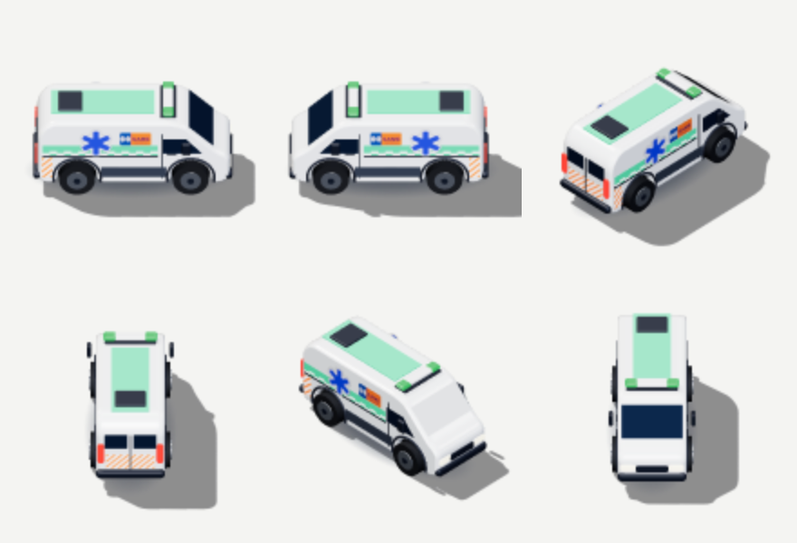

# Emergex · Aplicación web

**Centro operativo para emergencias médicas y asistencia domiciliaria.** Un despachante recibe el caso, asigna una unidad, la sigue en un mapa en tiempo real y deja el servicio listo para auditar y facturar, todo desde el navegador.



<sub>Las ambulancias del mapa se renderizan en 3D con three.js, un sprite por rumbo y por estado.</sub>

---

## En 60 segundos

| Pregunta | Respuesta |
|---|---|
| ¿Qué es? | La interfaz web de Emergex: operación, flota, clínica, cobertura y administración financiera. |
| ¿Para quién? | Despachantes, profesionales, administradores, contadores y auditores. Cada rol tiene su propio menú y permisos. |
| ¿Cómo está hecha? | Angular 21 con componentes standalone y Signals, Tailwind CSS, MapLibre GL y three.js. |
| ¿Cómo la levanto? | `npm install && npm start` con el backend en `http://localhost:8080`. Ver [Primeros pasos](#primeros-pasos). |
| ¿En qué estado está? | Lint sin advertencias, 546 pruebas en verde y build de producción correcto (verificado el 2026-11-10). |

## Contenido

1. [Primeros pasos](#primeros-pasos)
2. [Qué incluye](#qué-incluye)
3. [Mapa operativo en tiempo real](#mapa-operativo-en-tiempo-real)
4. [Arquitectura](#arquitectura)
5. [Autenticación y permisos](#autenticación-y-permisos)
6. [Diseño visual](#diseño-visual)
7. [Comandos](#comandos)
8. [Configuración y despliegue](#configuración-y-despliegue)
9. [Calidad](#calidad)
10. [Documentación del proyecto](#documentación-del-proyecto)

---

## Primeros pasos

### Requisitos

- Node.js (probado con la 24) y npm.
- El backend de Emergex corriendo en `http://localhost:8080`. Está en la carpeta hermana `backend/`.

### Pasos

```bash
npm install
npm start
```

Abrí `http://localhost:4200`. El servidor recarga solo cuando cambiás un archivo.

`npm start` usa la configuración de desarrollo, que reenvía `/api` y `/websocket` al backend a través de [`proxy.conf.json`](proxy.conf.json).

### Usuarios de prueba

Vienen del seed de desarrollo del backend (`backend/src/main/resources/config/liquibase/data/user.csv`).

| Usuario | Contraseña |
|---|---|
| `admin` | `admin` |
| `user` | `user` |
| `medico1` | `user` |

> Son credenciales de desarrollo. No las uses en ningún entorno compartido ni público.

### Para ver unidades en el mapa

Abrí `/map` y acercate a San Salvador de Jujuy. Las ambulancias aparecen cuando el backend tiene unidades con latitud y longitud cargadas. Si el mapa está vacío, revisá primero los datos de la flota.

---

## Qué incluye

Cada área es una carpeta de [`src/app/features`](src/app/features) y se carga de forma diferida.

| Área | Ruta | Qué permite |
|---|---|---|
| Operaciones | `/dashboard` | Tablero de emergencias activas y detalle de cada caso. |
| Mapa | `/map` | Unidades en vivo sobre el mapa. |
| Flota y Personal | `/fleet`, `/staff` | Ambulancias, tripulación y turnos. |
| Eventos e incidentes | `/events`, `/incidents` | Cobertura de eventos e incidentes. |
| Pacientes y grupos familiares | `/patients`, `/grupos-familiares` | Afiliados y su núcleo familiar. |
| Instituciones y planes | `/institutions`, `/plans` | Convenios, padrones y planes comerciales. |
| Obras sociales | `/obras-sociales` | Catálogo de obras sociales. |
| Clínico y auditoría médica | `/clinico`, `/auditoria-medica` | Atención, historia clínica y auditoría de prestaciones. |
| Tripulación | `/tripulacion` | Vista de trabajo de choferes y personal de campo. |
| Turnos | `/turnos` | Agenda y turnos. |
| Facturación | `/prefacturacion`, `/facturacion` | Del lote de prestaciones al comprobante. |
| Administración financiera | `/cuentas-corrientes`, `/tesoreria`, `/compras` | Cuentas corrientes, cobranzas, pagos y compras. |
| Zonas y tarifas | `/zonas-tarifas` | Tarifario por zona. |
| Internación | `/internacion` | Seguimiento de internación domiciliaria. |
| Encuestas y comunicaciones | `/encuestas`, `/communications` | Satisfacción y mensajería. |
| Analítica y gestión | `/analytics`, `/management` | Indicadores. |
| Historial de asistencias | `/asistencias/historial` | Consulta de servicios pasados. |
| Inventario | `/inventario` | Insumos. |
| Hospitales | `/hospitals` | Hospitales y centros asistenciales. |
| Administración | `/administracion`, `/admin/global` | Configuración y administración global. |

Además hay una búsqueda global (`⌘K`), notificaciones, un selector de institución y un interruptor de tema claro y oscuro.

---

## Mapa operativo en tiempo real

El mapa es la pieza más trabajada de la aplicación. Vive en [`src/app/shared/components/map/operations-map`](src/app/shared/components/map/operations-map).

| Capacidad | Cómo funciona |
|---|---|
| Base del mapa | MapLibre GL 5, con capas para unidades y etiquetas. |
| Posiciones en vivo | Llegan por WebSocket (STOMP y SockJS, en `core/websocket`) a los stores de flota y emergencias, y el mapa las dibuja. La URL sale de `wsUrl` en el entorno. |
| Ambulancias en 3D | [`ambulance-3d.ts`](src/app/shared/components/map/operations-map/ambulance-3d.ts) modela un furgón alto con three.js: carrocería extruida con bisel, arcos de rueda reales, barra de luces, banda reflectiva con chevrones y el logo SAME. |
| Rendimiento | El modelo se renderiza una vez por rumbo y por estado, y el resultado se guarda como sprite. El mapa solo dibuja imágenes. |
| Carga diferida | `three` se importa dinámicamente, así que queda en un chunk aparte que solo se descarga al abrir un mapa. |
| Rumbo | [`rumbo-unidad.ts`](src/app/shared/components/map/operations-map/rumbo-unidad.ts) decide hacia dónde mira la unidad según cómo se desplaza, e ignora el ruido del GPS. |
| Estado | El color de la banda indica el estado de la unidad: disponible, en ruta, en traslado. Una `P` marca las unidades paradas. |
| Respaldo | Si el navegador no puede crear un contexto WebGL, el mapa usa el dibujo 2D de [`ambulance-icon.ts`](src/app/shared/components/map/operations-map/ambulance-icon.ts). |

---

## Arquitectura

```text
src/app/
├── core/          Lo que vive una sola vez en toda la app
│   ├── auth/          Servicio de sesión, guards por rol e interceptores
│   ├── interceptors/  Claves de idempotencia y correlación para las escrituras
│   ├── websocket/     Cliente STOMP para el seguimiento en vivo
│   ├── stores/        Estado compartido (emergencias, flota, sesión, notificaciones)
│   ├── theme/         Tema claro y oscuro
│   ├── i18n/          Formatos de fecha, moneda y números
│   └── menu/, navigation/, notifications/, utils/
├── data-access/   DTOs que reflejan los contratos del backend
├── features/      Una carpeta por área funcional, cargada de forma diferida
├── layout/        Estructura general: barra lateral y barra superior
└── shared/        Componentes, pipes y utilidades reutilizables
    └── components/    Tarjetas, modales, estados vacíos, KPIs, mapas, gráficos…
```

**Convenciones principales**

| Tema | Decisión |
|---|---|
| Componentes | Todos son standalone. No hay NgModules. |
| Rutas | Cada área se carga con `loadComponent` o `loadChildren`, así el primer arranque descarga solo lo necesario. |
| Reactividad | Signals y la sintaxis de control de flujo moderna (`@if`, `@for`). |
| Datos | Los DTOs de `data-access` siguen el contrato del backend. |
| Escrituras | Un interceptor agrega `X-Idempotency-Key` y `X-Correlation-Id` a cada POST, PUT, PATCH y DELETE, así un reintento no duplica el registro. |
| Estilos | Variables CSS y clases utilitarias de Tailwind. Se evita el CSS en línea (ver [`DESIGN.md`](DESIGN.md)). |

---

## Autenticación y permisos

- **Sesión.** Ingresa por `/login` con JWT. La sesión se renueva contra `/api/auth/refresh`.
- **Guards.** `authGuard` protege las rutas internas y `roleGuard(...roles)` restringe las que dependen del rol. Por ejemplo, `/dashboard` exige alguno de `ROLE_DESPACHANTE`, `ROLE_OPERADOR`, `ROLE_ADMIN`, `ROLE_ADMINISTRADOR` o `ROLE_PROPIETARIO`.
- **Menú.** La barra lateral se arma según el rol del usuario, desde `core/menu` y `core/navigation`.
- **Sin permiso.** Si el rol no alcanza, la aplicación muestra la pantalla `/access-denied`.

Roles disponibles en el seed: `ROLE_ADMIN`, `ROLE_USER`, `ROLE_PROPIETARIO`, `ROLE_ADMINISTRADOR`, `ROLE_DESPACHANTE`, `ROLE_PROFESIONAL`, `ROLE_CONTADOR`, `ROLE_CHOFER`, `ROLE_MEDICO_CAMPO`, `ROLE_OPERADOR` y `ROLE_AUDITOR`.

> El menú y los permisos de la API se definen por separado. Si un rol ve una pantalla pero el backend le devuelve `403`, la diferencia está en la autoridad que exige el endpoint.

---

## Diseño visual

La interfaz busca el aspecto de un centro de control: oscuro por defecto, legible en ambientes de mucha luz y con alertas de color solo donde importan.

| Pieza | Detalle |
|---|---|
| Estilos | Tailwind CSS 3 con `@tailwindcss/forms`. |
| Tokens | Variables CSS (`--bg-deep`, `--bg-elevated`, `--surface-glass`, `--border-glass`) definidas en `src/styles.css`. |
| Temas | El atributo `data-theme` en `<html>` alterna entre claro y oscuro. Lo controla `ThemeService`. |
| Tarjetas | Efecto vidrio esmerilado en modo oscuro y fondo opaco en modo claro, para no perder contraste. |

La guía completa, con paleta, tipografía y reglas de uso, está en [`DESIGN.md`](DESIGN.md).

---

## Comandos

| Comando | Qué hace |
|---|---|
| `npm start` | Servidor de desarrollo en `http://localhost:4200`. |
| `npm run start:dev` | Igual, pero fija el puerto 4200 y abre el navegador. |
| `npm run build` | Compila la aplicación. |
| `npm run build:prod` | Compila para producción en `dist/emergex-frontend`. |
| `npm run watch` | Recompila al guardar, con la configuración de desarrollo. |
| `npm test` | Pruebas unitarias en modo interactivo. |
| `npm run test:ci` | Pruebas unitarias una sola vez. |
| `npm run lint` | ESLint sobre `src/**/*.ts`, sin tolerar advertencias. |

---

## Configuración y despliegue

### Entornos

| Archivo | `apiUrl` | Uso |
|---|---|---|
| `src/environments/environment.ts` | `http://localhost:8080` | Desarrollo. Incluye también `wsUrl` para el WebSocket. |
| `src/environments/environment.prod.ts` | `https://aliviar.appcanvas.store` | Producción. |

### Imagen Docker

El [`Dockerfile`](Dockerfile) compila en dos etapas: construye con `node:20-alpine` y sirve el resultado con `nginx:1.27-alpine`. La configuración de [`nginx.conf`](nginx.conf) redirige las rutas desconocidas a `index.html`, para que el enrutador de Angular las resuelva.

```bash
docker build -t emergex-frontend .
```

La orquestación completa (base de datos, backend, proxy y certificados) vive en la carpeta hermana `docker/`.

---

## Calidad

Estado verificado el 2026-11-10:

| Chequeo | Resultado |
|---|---|
| `npm run lint` | Sin advertencias ni errores. |
| `npm run test:ci` | 93 archivos y 546 pruebas, todas en verde. |
| `npm run build:prod` | Correcto. El paquete inicial pesa 1,91 MB (446 kB transferidos). |

Las pruebas usan [Vitest](https://vitest.dev/) a través de `ng test`. Los archivos de prueba conviven con el código, con el sufijo `.spec.ts`.

---

## Documentación del proyecto

| Quiero… | Lee |
|---|---|
| Conocer la guía de diseño | [`DESIGN.md`](DESIGN.md) |
| Ver las reglas de trabajo y los comandos de verificación | [`AGENTS.md`](AGENTS.md) y [`CLAUDE.md`](CLAUDE.md) |
| Entender las decisiones de seguridad | [`Implementar_seguridad_angular.md`](Implementar_seguridad_angular.md) |
| Leer la especificación de la aplicación | [`SDD-v2.md`](SDD-v2.md) (la versión anterior es [`SDD.md`](SDD.md)) |
| Revisar el módulo de internación domiciliaria | [`docs/sdd-internacion-domiciliaria.md`](docs/sdd-internacion-domiciliaria.md) |

> Parte de esta documentación es histórica y puede no reflejar el estado actual del código. Ante una duda, el código manda.
